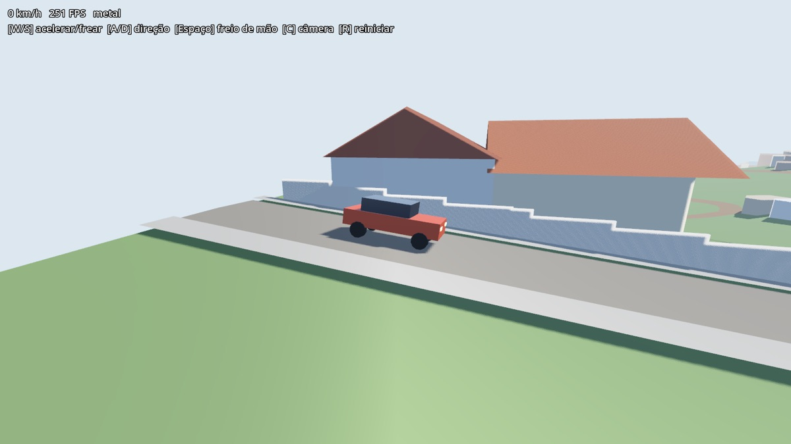
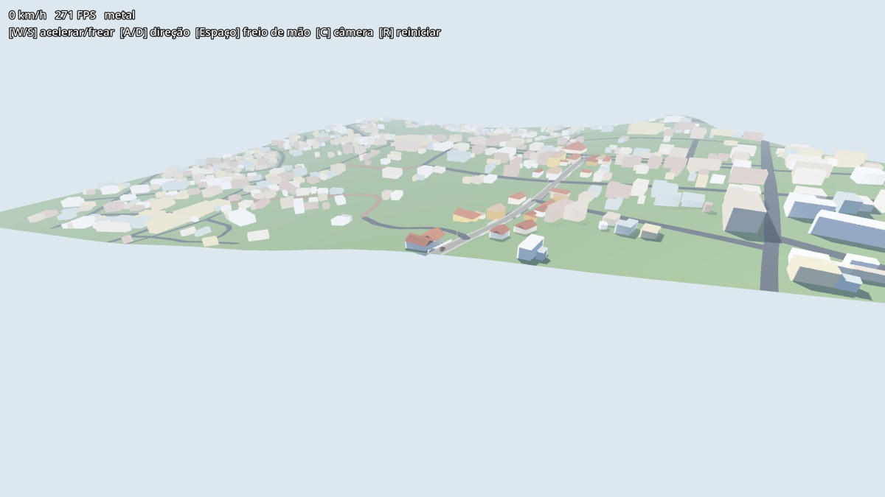

# 009 — Piloto de aparência: Rua 15 de Novembro

- **Status:** protótipo validado (29/10/2026)
- **Ticket:** #16 · **Mapa:** #1

## Por que

A pesquisa de referência visual (#16) mediu que o dado aberto quase não diz como a cidade *parece*. No anel 1:

- o OSM não tem nenhuma árvore, nenhum poste e nenhuma tag de telhado ou cor;
- 63% das vias não informam o pavimento;
- os prédios do Overture não têm altura;
- KartaView e Panoramax têm zero fotos.

A aparência então vem de **regras escritas pelo Founder**: o padrão da rua, não casas específicas. O pipeline aplica a regra a cada prédio. Imagem do Google não entra no pipeline (CONTRIBUTING); o Founder pode consultá-la para escrever a regra com as próprias palavras.

## O que foi construído

- **`pipeline/regras/residencial-interior.toml`:** a regra da rua residencial de interior, com o texto de origem e os valores (tipologias, paleta de fachada, telha, muro, calçada, postes).
- **`pipeline/aparencia.py`:** aplica a regra aos prédios a até `raio_m` de uma via. Gera:
  - térrea ou sobrado sorteado pela área;
  - telhado de duas águas no lado comprido;
  - pavimento próprio;
  - calçada elevada pelo meio-fio;
  - muro ou grade na frente do lote recuado, em pedaços que acompanham a ladeira;
  - postes com fiação.

  Todo sorteio usa hash: o resultado se repete a cada execução (decisão 003).
- **`pipeline/tiles/piloto-15nov.toml`:** a mesma área da fatia, com o spawn na 15 de Novembro e a regra ligada.
- **Prédio em cima da pista (vale para todos os tiles):** a pegada do Overture vem de detecção por satélite (~74% Google Open Buildings) e às vezes erra.
  - O prédio com mais da metade da pegada sobre a pista é descartado.
  - O que só encosta perde a parte que invade a rua.
  - Na fatia: 1 descartado e 30 recortados.
  - A primeira versão, que descartava pelo tamanho da área em cima da pista, apagava casas reais coladas à calçada (7 de 8).

## Medições

| | Fatia (sem regra) | Piloto |
|---|---|---|
| FPS médio (bench, Metal, M4) | 199 | 209–233 |
| p99 | 31 ms | 27–30 ms |
| Triângulos | — | 100 mil |
| Prédios com a regra | — | 26 · 83 pedaços de muro · 7 postes |

O p99 de ~30 ms aparece também na fatia sem a regra. Ele não vem do piloto (o 007 mediu 3,7 ms; investigar à parte).

## Teste do Founder ao volante

"Achei interessante pra um protótipo." Bugs conhecidos:

- **Iluminação:** a sombra fica azulada pela luz do céu e o sol está fixo. Fachada e muro parecem azuis.
- **Mistura de terreno:** juntas entre pavimento, calçada e relevo, e cruzamento com outras vias.
- A 15 de Novembro fica na borda do tile.

## Para depois

- Regras para os outros tipos de bairro (centro histórico, comércio, periferia).
- Fachada (janelas, portas), desgaste, árvores.
- Estética PS1 com textura pixelada: ideia levantada, **não decidida**.
