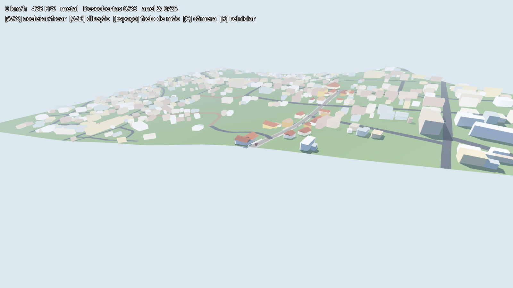
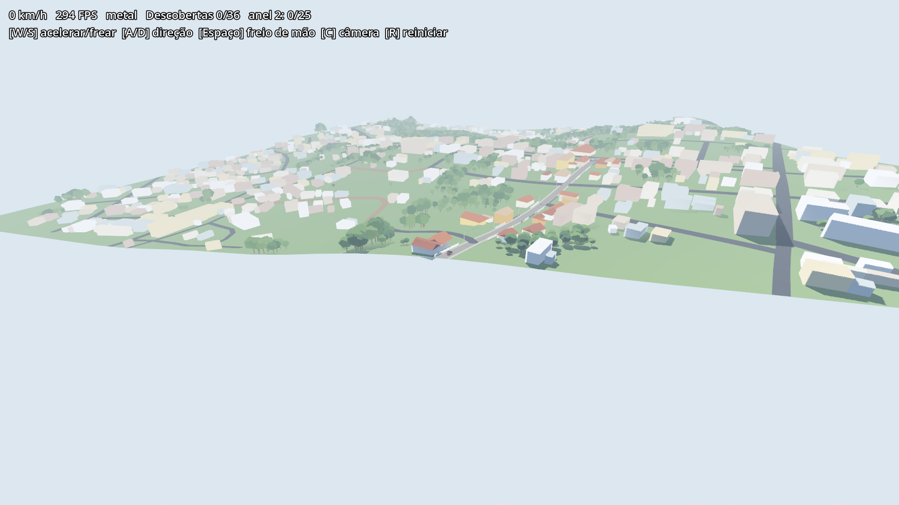

# 013 — Árvores do mapa de copa (piloto)

- **Status:** protótipo validado no piloto da Rua 15 de Novembro (29/10/2026)
- **Mapa:** #1 · degrau 2 da escada visual (referência ao passar)

## Por que

O OSM não tem nenhuma árvore no anel 1 (decisão 009). O teste do [Arnis](https://github.com/louis-e/arnis) (Apache-2.0), que gera mundos de Minecraft a partir do OSM, mostrou de onde ele tira a vegetação. Não é Google 3D nem leitura de foto em tempo real. São bases abertas já prontas:

- **Meta/WRI High Resolution Canopy Height Maps:** altura da copa a ~1,2 m por pixel, estimada por IA sobre imagem Maxar. CC BY 4.0.
- **ESA WorldCover 2021:** cobertura do solo a 10 m. CC BY 4.0. Fica para depois (bairro × mato × campo).

O Arnis entra só como referência de quais fontes e regras usar. O visual dele (voxel) não entra (decisão 001 e "fora de escopo").

## O que foi construído

- **`pipeline/arvores.py`:** lê por HTTP só a janela do tile no bucket público (~11 s) e guarda em `data/chm/raw/<tile>.tif`. A grade de 8 m põe uma árvore em cada célula com pelo menos metade de copa ≥ 3 m, no pixel mais alto da célula e com a altura medida. Ficam de fora árvores na pista (com folga de calçada) e dentro de prédio.
- **Geometria:** tronco de 5 lados com colisão e copa icosaédrica chapada sem colisão, em 4 verdes sorteados por hash.
- **Liga por tile:** seção `[arvores]` no `.toml`. Hoje está ligada só no `piloto-15nov`.

## Medições (piloto, 800 m)

| | Antes | Pico local (1ª tentativa) | Grade de 8 m |
|---|---|---|---|
| Árvores | 0 | 355 | 2.767 |
| Copa real coberta | 0% | 6% | perto da copa medida (22% da área) |
| Triângulos do tile | 114 mil | — | 211 mil |
| FPS médio (`--bench`, M4) | 390 | 389 | 238 (p99 26 ms) |

O pico local achava uma árvore por mancha, e a mata contínua sumia. A grade preenche a mancha.

## A resolver antes de ligar no anel 1

- **Custo:** o anel 1 tem ~14× a área do piloto, então seriam ~40 mil árvores. Precisa de MultiMesh/LOD ou de árvores agrupadas por mancha antes de ligar.
- **Picos no p99:** investigar se vêm da colisão dos troncos ou da sombra das copas.
- **Calibrar com o Founder:** densidade, tamanho da copa e verdes, jogando.

## Antes e depois (`--bench`, passada alta)

